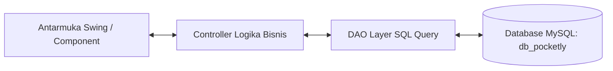

# Pocketly

Pocketly adalah sistem informasi manajemen ritel dan pemesanan daring terintegrasi (*omnichannel*) yang menghubungkan operasional kasir gerai fisik (*Point of Sale*/POS) dengan platform belanja daring secara terpusat guna menyinkronkan stok barang secara *real-time* dan mengeliminasi kendala *siloed system* (kondisi di mana aplikasi, database, atau sistem informasi dalam suatu organisasi berjalan secara terpisah, mandiri, dan tidak saling terhubung atau berkomunikasi satu sama lain).

Sistem ini menggunakan arsitektur *supertype-subtype* pada pengelolaan akun pengguna dan transaksi, menerapkan aturan bisnis di mana pemotongan stok utama hanya tereksekusi setelah pembayaran terverifikasi lunas, serta menyediakan layanan fleksibel berbasis *Pick-up* maupun Pesan antar. Didukung oleh pengamanan hak akses DCL untuk mengunci jejak audit transaksi kasir dan kemampuan pelaporan inventaris terpadu, Pocketly dirancang untuk mengoptimalkan operasional ritel sekaligus mendukung pencapaian SDGs 9 (Industri, Inovasi, dan Infrastruktur) dan SDGs 12 (Konsumsi dan Produksi yang Bertanggung Jawab).

---

## Kontributor

| Nama | NIM | Kelas | Kontribusi |
|------|-------|------|----------|
| Wahid Nur Hakim | 2509116016 | A | Perancangan dan pembuatan ERD, Membuat Laporan, Pembuatan Database, eksekusi query |
| Yuzar Rahmat Rafi Alhaq | 2509116025 | A | Perancangan rencana pengerjaan, membantu laporan dan pencarian jurnal, perancangan dan pembuatan program, memastikan beban kerja yang merata, membantu revisi masing-masing anggota |
| Muhammad Ihsan Kamil | 2509116035 | A | Pembuatan laporan, Perancangan ERD, Perancangan dan Pembuatan Flowchart, eksekusi query, pembuatan prototype UI |
| Riaz Ramadhan Al Fattah | 2509116106 | C | Perancangan dan pembuatan program, pembuatan GUI, pembuatan usecase, pembuatan laporan |

---

## Fitur Utama Program

| Modul / Aspek | Deskripsi Layanan & Fitur |
|---------------|---------------------------|
| **Point of Sale (POS Kasir)** | Pemrosesan pemesanan fisik di toko secara cepat, perhitungkan kembalian otomatis, pemotongan stok langsung, dan pencetakan riwayat transaksi kasir. |
| **Katalog & Pemesanan Daring** | Antarmuka pengguna (pelanggan) untuk menjelajahi katalog produk, menambahkan keranjang belanja, serta memilih metode layanan (*Pick-up* atau Pesan Antar). |
| **Manajemen Inventaris Terpusat** | Inventarisasi produk secara *omnichannel* dengan mekanisme pemotongan stok otomatis yang tereksekusi hanya setelah transaksi pembayaran terverifikasi lunas. |
| **Dashboard Pengawas & Verifikasi** | Antarmuka petugas/admin untuk memverifikasi pembayaran pesanan masuk (*online order*), mengelola data master produk, serta memantau grafik statistik pendapatan harian/bulanan. |
| **Autentikasi Berbasis Role** | Pembagian hak akses berhirarki antara **Pelanggan**, **Petugas Kasir/Admin**, dan **Pengelola Sistem** dengan pengamanan hak akses level basis data DCL. |

---

## Tech Stack

* **Bahasa Pemrograman:** Java (JDK 17+)
* **Database Management System:** MySQL (`db_pocketly`)
* **GUI / Framework UI:** Java Swing dengan Custom Components (Flat UI Elements)
* **Konektivitas Basis Data:** JDBC (Java Database Connectivity) via MySQL Connector/J
* **IDE & Build Tool:** Apache NetBeans IDE (Ant / Maven)

---

## Perancangan Sistem

### ERD (Entity Relationship Diagram)
#### Logical Model


#### Relational Model


---

### Use Case Diagram


---

### Flowchart Sistem

MASIH PROSES PEMASUKKAN

---

## Struktur Folder / Package

Program disusun rapi mengikuti pola arsitektur **Model-View-Controller (MVC)** yang dikombinasikan dengan pola **Data Access Object (DAO)** untuk memisahkan logika antarmuka, logika bisnis, dan query basis data:

```
Pocketly Capstone/
├── README.md
├── database/
│   └── db_pocketly.sql
└── src/
    └── com/
        └── pocketly/
            ├── Main.java
            ├── component/
            │   ├── AvatarLabel.java
            │   ├── BadgeLabel.java
            │   ├── ChartPanel.java
            │   ├── NavPill.java
            │   ├── RoundButton.java
            │   ├── RoundPanel.java
            │   ├── RoundPasswordField.java
            │   └── RoundTextField.java
            ├── controller/
            │   ├── AuthController.java
            │   ├── KasirController.java
            │   ├── KatalogController.java
            │   ├── KeranjangController.java
            │   ├── PendapatanController.java
            │   ├── ProdukAdminController.java
            │   ├── ProfilController.java
            │   ├── RiwayatController.java
            │   ├── StatusController.java
            │   └── VerifikasiController.java
            ├── dao/
            │   ├── KategoriDAO.java
            │   ├── KeranjangDAO.java
            │   ├── PelangganDAO.java
            │   ├── PenggunaDAO.java
            │   ├── PetugasDAO.java
            │   ├── ProdukDAO.java
            │   └── TransaksiDAO.java
            └── model/
                ├── DetailTransaksi.java
                ├── KasirItem.java
                ├── Kategori.java
                ├── KeranjangItem.java
                ├── Pelanggan.java
                ├── Pengguna.java
                ├── Petugas.java
                ├── Produk.java
                └── Transaksi.java

```

### Rincian Peran Package

| Package / Directory | Kelas Utamanya | Deskripsi Peran |
| --- | --- | --- |
| `com.pocketly` | `Main.java` | Titik awal (*entry point*) eksekusi program Pocketly. |
| `com.pocketly.component` | `RoundPanel`, `RoundButton`, `ChartPanel` | Komponen custom Swing GUI untuk menyajikan antarmuka modern (rounded corners, visual avatar, badge status, grafik pendapatan). |
| `com.pocketly.controller` | `AuthController`, `KasirController`, `ProdukAdminController` | Menangani alur logika bisnis, navigasi antarmuka, dan menghubungkan input pengguna ke lapisan DAO. |
| `com.pocketly.dao` | `ProdukDAO`, `TransaksiDAO`, `PenggunaDAO` | Mengisolasi seluruh perintah query SQL (`SELECT`, `INSERT`, `UPDATE`, `DELETE`) menggunakan `PreparedStatement`. |
| `com.pocketly.model` | `Pengguna`, `Pelanggan`, `Petugas`, `Produk`, `Transaksi` | Berisi kelas entitas data dengan enkapsulasi variabel yang merepresentasikan struktur tabel di `db_pocketly`. |
| `database/` | `db_pocketly.sql` | Skema struktur tabel basis data MySQL beserta data sampel awal. |

---

## Penjelasan Penerapan 4 Pilar OOP

1. **Encapsulation (Enkapsulasi)**
* Seluruh atribut entitas data pada package `com.pocketly.model` (seperti `id_pengguna`, `nama`, `stok`, `harga`, `total_harga`) dideklarasikan berakses **`private`**.
* Pengaksesan dan modifikasi data wajib melalui fungsi **`getter`** dan **`setter`** publik untuk menjaga integritas data agar tidak diubah secara bebas di luar kelasnya.


2. **Inheritance (Pewarisan)**
* **Supertype-Subtype Pengguna:** Kelas `Pengguna` bertindak sebagai *superclass* (parent) yang memuat variabel umum (`id`, `username`, `password`, `role`), kemudian diturunkan (*extends*) menjadi kelas *subclass* seperti `Petugas` (Admin/Kasir) dan `Pelanggan`.
* Memungkinkan penggunaan ulang kode (*code reusability*) secara efisien tanpa perlu mendeklarasikan ulang variabel umum.


3. **Polymorphism (Polimorfisme)**
* **Method Overriding:** Kelas turunan mengimplementasikan kembali metode dari kelas induk atau interface untuk memberikan perilaku spesifik. Contohnya kalkulasi total bayar atau pencetakan rincian transaksi antara transaksi kasir *offline* dan transaksi pesan-antar *online*.
* **Method Overloading:** Penggunaan nama metode yang sama dengan kombinasi parameter berbeda pada lapisan Controller/DAO (misalnya pemanggilan `pencarianProduk(String keyword)` dan `pencarianProduk(int idKategori)`).


4. **Abstraction (Abstraksi)**
* Penerapan pola **DAO (Data Access Object)** memisahkan secara total kompleksitas operasi basis data JDBC dari lapisan visual antarmuka pengguna.
* Controller hanya perlu memanggil metode abstrak seperti `transaksiDAO.tambahTransaksi(...)` atau `produkDAO.updateStok(...)` tanpa harus mengetahui detail implementasi sintaks SQL yang dieksekusi di tingkat basis data.


---

## Cara Penggunaan Program

### 1. Persiapan Basis Data MySQL

1. Buka aplikasi manajemen MySQL (seperti **phpMyAdmin** atau **MySQL Workbench**).
2. Buat database baru bernama **`db_pocketly`**.
3. Impor berkas SQL yang tersedia pada lokasi `database/db_pocketly.sql`.

### 2. Membuka Proyek di NetBeans

1. Jalankan **Apache NetBeans IDE**.
2. Pilih menu **File** > **Open Project**, lalu arahkan ke lokasi direktori:
`C:\Users\Acer\OneDrive\Documents\NetBeansProjects\Pocketly Capstone`
3. Pastikan *library* **MySQL Connector/J** sudah terpasang pada bagian `Libraries` proyek.
4. Klik kanan berkas `com.pocketly.Main.java` lalu pilih **Run File** (`Shift + F6`).

### 3. Alur Komunikasi Antar-Lapisan



Setiap aktivitas pada UI (kasir, keranjang, verifikasi) diproses oleh `Controller`, dikirim ke `DAO` yang mengeksekusi query SQL ke `db_pocketly`, dan mengembalikan hasilnya secara *real-time* ke tampilan UI pengguna.

```

```
