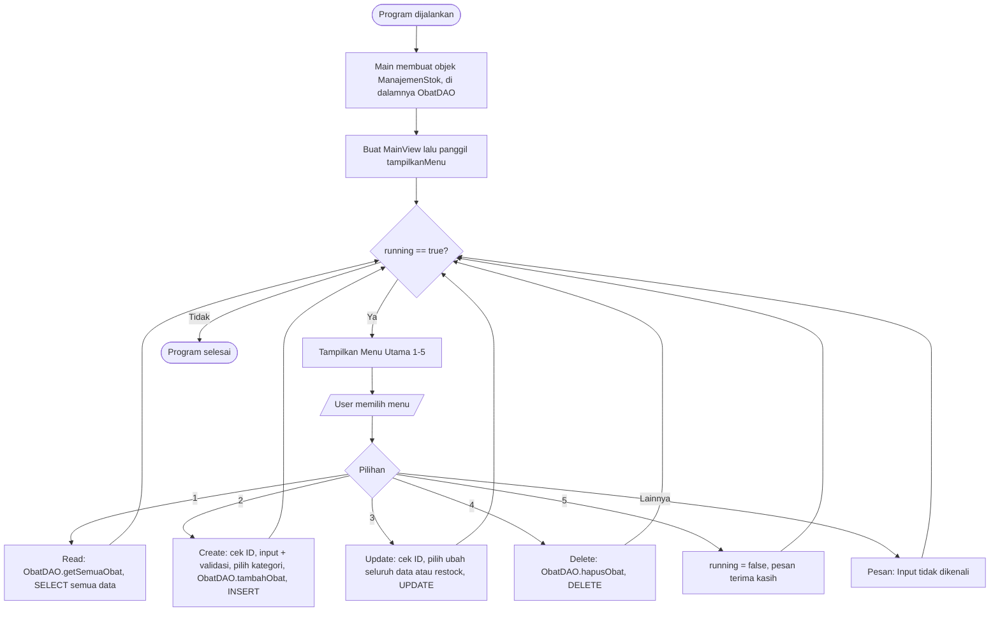
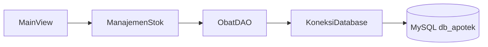

# Pocketly

Pocketly adalah sistem informasi manajemen ritel dan pemesanan daring terintegrasi (omnichannel) yang menghubungkan operasional kasir gerai fisik (Point of Sale/POS) dengan platform belanja daring secara terpusat guna menyinkronkan stok barang secara real-time dan mengeliminasi kendala siloed system (kondisi di mana aplikasi, database, atau sistem informasi dalam suatu organisasi berjalan secara terpisah, mandiri, dan tidak saling terhubung atau berkomunikasi satu sama lain). Sistem ini menggunakan arsitektur supertype-subtype pada pengelolaan akun pengguna dan transaksi, menerapkan aturan bisnis di mana pemotongan stok utama hanya tereksekusi setelah pembayaran terverifikasi lunas, serta menyediakan layanan fleksibel berbasis Pick-up maupun Pesan antar. Didukung oleh pengamanan hak akses DCL untuk mengunci jejak audit transaksi kasir dan kemampuan pelaporan inventaris terpadu, Pocketly dirancang untuk mengoptimalkan operasional ritel sekaligus mendukung pencapaian SDGs 9 dan SDGs 12.

---

### Kontributor

| Nama | NIM | Kelas | Kontribusi | 
|------|-------|------|----------| 
| Wahid Nur Hakim | 2509116016 | A | Perancangan dan pembuatan ERD, Membuat Laporan, Pembuatan Database, eksekusi query |
| Yuzar Rahmat Rafi Alhaq | 2509116025 | A | Perancangan rencana pengerjaan, membantu laporan dan pencarian jurnal, perancangan dan pembuatan program, memastikan beban kerja yg merata, membantu revisi masing - masing anggota|
| Muhammad Ihsan Kamil | 2509116035 | A | Pembuatan lapoaran, Perancangan ERD, Perancangan dan Pembuatan Flowchart, eksekusi query, pembuatan prototype UI |
| Riaz Ramadhan Al Fattah | 2509116106 | C | Perancangan dan pembuatan program, pembuatan GUI, pembuatan usecase, pembuatan laporan |

---

## Fitur Utama Program (MASIH TEMPLATE, BELUM DIUBAH)

| Aspek | Mini Project 3 | Mini Project 4 |
|-------|----------------|----------------|
| Penyimpanan data | `ArrayList<Obat>` (sementara, hilang saat program ditutup) | Database **MySQL** (permanen) |
| Akses data | `ManajemenStok` mengelola list secara langsung | `ManajemenStok` meneruskan ke **`ObatDAO`** yang menjalankan SQL dengan **PreparedStatement** |
| Koneksi database | Tidak ada | Class `KoneksiDatabase` (package `config`) memakai `DriverManager` |
| Dummy data | Dimasukkan lewat kode di `Main.java` | Diisi lewat **file `.sql`** (`database/db_apotek.sql`) |
| Isi `Main.java` | Membuat controller, mengisi dummy data, menjalankan view | Hanya membuat controller dan menjalankan view |
| Pencarian ID | Dicari di `ArrayList` dengan `equalsIgnoreCase` | Query `SELECT ... WHERE id_obat = ?` (perbandingan huruf besar/kecil mengikuti collation MySQL, default-nya tidak membedakan) |
| Class baru | – | `ObatDAO`, `KoneksiDatabase`, `TesKoneksi` |
| Getter subclass | `efekSamping` dan `namaDokter` tidak punya getter | Ditambahkan `getEfekSamping()` dan `getNamaDokter()` karena dibutuhkan DAO untuk menyimpan ke database |


---

## Tech Stack | Bahasa, Database, Framework, Library (MASIH TEMPLATE, BELUM DIUBAH)

---

## Perancangan Sistem
### ERD


### UseCase

### Flowchart 

---

## Struktur Folder/Package (MASIH TEMPLATE, BELUM DIUBAH)

Program dipisah ke dalam package sesuai pola **MVC (Model – View – Controller)**, ditambah package `Main` sebagai titik masuk program, `Utils` sebagai kelas bantu, dan **`config`** (baru) untuk koneksi database.

```
Minpro-4-PBO-ManajemenStokObatApotek/
├── README.md
├── database/
│   └── db_apotek.sql
└── src/
    ├── Main/
    │   └── Main.java
    ├── Model/
    │   ├── InfoObat.java
    │   ├── Obat.java
    │   ├── ObatBebas.java
    │   └── ObatResep.java
    ├── Controller/
    │   ├── ManajemenStok.java
    │   └── ObatDAO.java
    ├── View/
    │   └── MainView.java
    ├── Utils/
    │   └── ValidasiInput.java
    └── config/
        ├── KoneksiDatabase.java
        └── TesKoneksi.java
```

| Package | File | Peran |
|---------|------|-------|
| `Main` | `Main.java` | Titik masuk program: membuat controller lalu menjalankan view |
| `Model` | `InfoObat.java` | **Interface** – kontrak `tampilkanInfo()` |
| `Model` | `Obat.java` | **Abstract class / superclass** – atribut & perilaku umum semua obat, mengimplementasikan `InfoObat` |
| `Model` | `ObatBebas.java` | **Subclass** dari `Obat` – menambah atribut `efekSamping` |
| `Model` | `ObatResep.java` | **Subclass** dari `Obat` – menambah atribut `namaDokter` |
| `Controller` | `ManajemenStok.java` | Perantara antara View dan DAO; menyediakan operasi CRUD (termasuk **overloading** `updateObat()`) |
| `Controller` | `ObatDAO.java` | **(Baru)** Satu-satunya class yang menjalankan query SQL ke tabel `obat` memakai `PreparedStatement` |
| `View` | `MainView.java` | Antarmuka pengguna: menu, membaca input keyboard, menampilkan tabel dan pesan |
| `Utils` | `ValidasiInput.java` | Kelas bantu untuk validasi input angka (dipanggil oleh View) |
| `config` | `KoneksiDatabase.java` | **(Baru)** Menyediakan koneksi ke database MySQL |
| `config` | `TesKoneksi.java` | **(Baru)** Program kecil untuk mengecek koneksi database berhasil atau tidak |
| `database` | `db_apotek.sql` | **(Baru)** Skema tabel `obat` dan dummy data awal |

**Alasan pemisahan:**

- **Model** berisi data obat beserta aturan datanya (atribut, getter/setter, dan format tampilan satu baris data).
- **Controller** berisi logika pengelolaan data. `ManajemenStok` tidak berinteraksi dengan `Scanner` maupun SQL; ia hanya meneruskan perintah ke `ObatDAO`.
- **DAO (`ObatDAO`)** memisahkan seluruh kode SQL dari View dan logika program, sehingga jika database atau query berubah, hanya satu class yang perlu diubah.
- **View** mengurus tampilan menu dan pengambilan input, lalu meneruskannya ke Controller.
- **Utils** memisahkan logika validasi.
- **config** memisahkan pengaturan koneksi (URL, user, password) dari class lain.

---

## Penjelasan Penerapan 4 Pilar OOP Dalam Program (MASIH TEMPLATE, BELUM DIUBAH ISINYA)


## Cara Penggunaan Program Dan Screenshot GUI nya (MASIH TEMPLATE, BELUM DIUBAH)
### 3.1 Diagram Alur


### 3.2 Alur Data antar Lapisan

`MainView` tidak pernah menyentuh SQL. Setiap permintaan melewati `ManajemenStok` → `ObatDAO` → `KoneksiDatabase` → MySQL, lalu hasilnya kembali dengan jalur yang sama.
### 3.3 Penjelasan Alur Langkah demi Langkah
#### Program Dijalankan (Run)

1. Method `main()` di `Main/Main.java` dieksekusi.
2. Dibuat objek `ManajemenStok app` (Controller). Di dalamnya terdapat objek `ObatDAO`.
3. **Tidak ada lagi dummy data yang dimasukkan lewat kode.** Data awal (`OBT01` dan `OBT02`) sudah berada di database karena file `db_apotek.sql` diimpor sebelum program dijalankan.
4. Dibuat objek `MainView view` dengan mengirim `app` ke constructor, lalu `view.tampilkanMenu()` dipanggil.
5. Variabel `running = true` dan program masuk ke perulangan `while (running)`.

**Screenshot: Program pertama kali dijalankan**


**Screenshot: Data dummy pada database (phpMyAdmin / MySQL) setelah import `db_apotek.sql`**


---

#### Menu Utama

Setiap iterasi perulangan menampilkan:

```
=== SISTEM MANAJEMEN STOK OBAT APOTEK ===
1. Tampilkan Semua Obat (Read)
2. Tambah Obat Baru (Create)
3. Ubah Data Obat (Update)
4. Hapus Obat (Delete)
5. Keluar
Pilih menu (1-5):
```

Input dibaca dengan `scanner.nextLine().trim()` lalu diproses menggunakan `switch`. Jika input bukan `1`–`5`, masuk ke `default` dan muncul pesan **"Input tidak dikenali! Harap masukkan angka 1-5."** lalu menu ditampilkan kembali.

**Screenshot: Input menu tidak valid**


---

#### Menu 1: Tampilkan Semua Obat (Read)

1. `tampilkanTabelObat()` di `MainView` memanggil `app.getSemuaObat()`, yang diteruskan ke `ObatDAO.getSemuaObat()`.
2. DAO menjalankan `SELECT * FROM obat`, lalu membuat objek `ObatBebas` atau `ObatResep` untuk setiap baris hasil query (tergantung kolom `kategori`).
3. Jika list kosong → tampil pesan **"Stok obat masih kosong."**
4. Jika ada data → dicetak header tabel (ID, Nama Obat, Kategori, Stok, Harga, Keterangan Khusus).
5. Perulangan `for` memanggil `o.tampilkanInfo()` untuk setiap obat. Karena **polymorphism**, obat bebas menampilkan `Efek: ...` sedangkan obat resep menampilkan `Dokter: ...`.

**Screenshot: Tampilan data dari database (dummy data)**


**Screenshot: Menu 1 saat data kosong (setelah semua data dihapus)**


---
